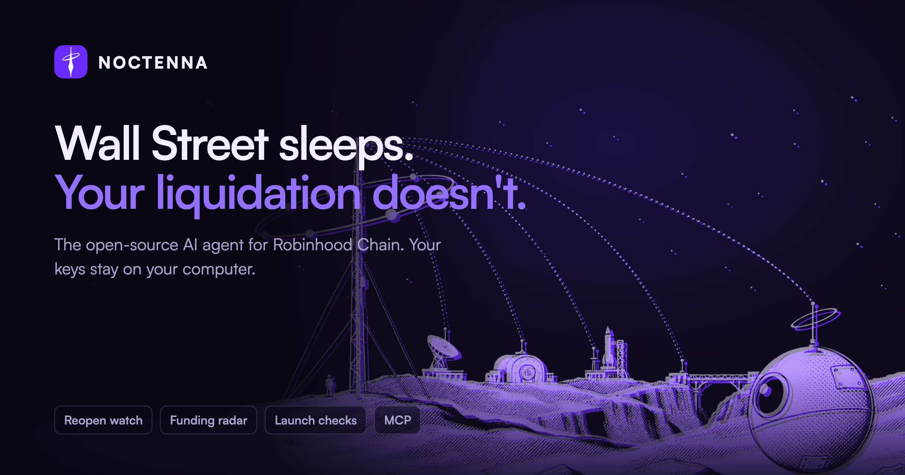

[](https://github.com/noctenna-lab/noctenna/actions/workflows/ci.yml)
[](https://noctenna.xyz)
[](https://www.npmjs.com/package/noctenna)
[](LICENSE)


Noctenna is an open-source AI agent for Robinhood Chain. It swaps, trades new launches on their bonding curve, checks launches, reads and trades perps on Arcus, reads Lighter, shows funding across both venues, watches stock perps over the weekend, and bridges out with Relay, from a wallet that stays on your computer.

**Information only, not financial advice.** Noctenna reports what the chain and the venues return. It never promises returns.

**Live on mainnet.** Noctenna runs on Robinhood Chain mainnet (chain 4663), where trades spend real funds, each one only after you approve its preview. To practise with test funds, switch to Robinhood Chain testnet (chain 46630) and Arcus testnet with `noctenna network testnet`.

## What you get

- **`noctenna`**: a terminal agent. It runs [Goose](https://github.com/aaif-goose/goose) (Apache-2.0) on a profile of its own, with the Noctenna tools as its only extension: no shell, file, browser or computer-control tools.
- **`noctenna mcp`**: the same tools over stdio for Claude Code, Codex, Cursor, Gemini CLI and any other MCP host.
- **`noctenna wallet`**: create, import, show the address, export (export only in an interactive terminal).
- **`noctenna radar`** and **`noctenna check <token>`**: the funding radar and the launch check as tables in your terminal. No wallet, no model and no setup, so `npx noctenna radar` works on its own.

You bring the model: an API key for Google Gemini, OpenRouter, Anthropic, OpenAI or any OpenAI-compatible endpoint, or a local model through Ollama. A free Gemini key ([aistudio.google.com/apikey](https://aistudio.google.com/apikey), no card) is enough to start, and OpenRouter has free models too. Noctenna never hosts, resells or proxies models.

| Area | Read | Write (prepare, then execute) |
|---|---|---|
| Wallet | address, ETH and token balances | send ETH or a token |
| Swap | quotes on Robinhood Chain | swap (mainnet) |
| Launches | new launches, one token, curve quote | buy, sell on the curve |
| Launch check | dev buy and what its wallet holds now, bundles, first-5-minute buyers, snipers, creator tax, fees, graduation, the deployer's other launches | none |
| Perps | markets, funding, open interest, order books, positions, orders, fills on Arcus; markets, funding, open interest, order books, positions on Lighter; **reopen watch** for stock perps (the weekend band, your liquidation price, the gap that reaches it, and how many past weekends opened that far) | Arcus: register an API key, market and limit orders with take-profit and stop-loss, cancel, leverage, and test collateral on testnet. Lighter is read-only in v1 |
| Radar | funding on Arcus and Lighter side by side, the widest gaps, closed stock markets and their fixed funding, the weekend gap against the last settlement | none |
| Bridge | Relay quotes into and out of Robinhood Chain for ETH and dollars | bridge out (mainnet) |

## Install

Node.js 22.12 or newer.

```sh
npm install -g noctenna
```

Or try it without installing anything:

```sh
npx noctenna radar                 # funding on Arcus and Lighter, the widest gaps first
npx noctenna check <token address> # the launch check for any launch token
```

To build it from source instead, or to work on the code, see [CONTRIBUTING.md](CONTRIBUTING.md).

## Set up

```sh
noctenna setup          # pick a provider, paste its key (checked, then kept in your OS keychain), pick a model
noctenna wallet create  # or: noctenna wallet import (hidden prompt)
noctenna                # start the agent
```

`setup` writes a Goose profile into `~/.config/noctenna/goose` (set `NOCTENNA_CONFIG_DIR` to move everything Noctenna keeps). The first `noctenna` downloads the official Goose release, checks it against a pinned SHA-256 and keeps it in `~/.config/noctenna/bin`. Your own Goose setup, if you have one, is never read or changed.

To practise on testnet (`noctenna network testnet`):

- Test ETH for gas: the official faucet, https://faucet.testnet.chain.robinhood.com
- Perps practice on Arcus testnet (https://testnet.arcus.xyz): ask the agent to deposit test collateral (it mints test USDG, which has no value) and to register an Arcus API key, then trade.

Other commands, all terminal only:

```sh
noctenna limit 200          # the daily spending limit in USD (default $100)
noctenna network            # show the network
noctenna network mainnet    # asks for a typed yes; mainnet moves real money
noctenna wallet export      # shows the private key after a typed confirmation
```

## Use it from Claude Code, Codex, Cursor or Gemini CLI

Every host runs the same command: `noctenna mcp`.

Claude Code:

```sh
claude mcp add noctenna -- noctenna mcp
```

or in `.mcp.json`:

```json
{
  "mcpServers": {
    "noctenna": { "command": "noctenna", "args": ["mcp"] }
  }
}
```

Codex, in `~/.codex/config.toml`:

```toml
[mcp_servers.noctenna]
command = "noctenna"
args = ["mcp"]
```

Cursor, in `~/.cursor/mcp.json` (or `.cursor/mcp.json` in a project):

```json
{
  "mcpServers": {
    "noctenna": { "command": "noctenna", "args": ["mcp"] }
  }
}
```

Gemini CLI, in `~/.gemini/settings.json`:

```json
{
  "mcpServers": {
    "noctenna": { "command": "noctenna", "args": ["mcp"] }
  }
}
```

These hosts have their own shell and file tools. Set them to ask before running Noctenna's `execute` tool, as `noctenna` itself does. Noctenna's terminal-only commands (key import and export, the limit, the network) refuse to run without an interactive terminal, so an agent driving a shell cannot use them.

## Safety model

- **Local keys.** The wallet key and any API keys live in your OS keychain (macOS Keychain, Windows Credential Manager, Secret Service on Linux). No server sees them and no tool returns them. `noctenna wallet export` works only in an interactive terminal.
- **Two steps for every change.** A `prepare` tool simulates the action and returns a plain-language summary: what happens, the amounts, the worst case after slippage, fees and approvals, and the network. Nothing is sent. Only `execute`, with that preview's id, within 2 minutes and once, sends it. `execute` checks the price and state again and refuses on any move beyond the slippage.
- **Exact approvals.** Token approvals are for the exact amount, never unlimited.
- **Daily limit.** A USD limit per UTC day (default $100), enforced inside `execute` and changed only with `noctenna limit` in a terminal. A perps order counts the initial margin it needs. Testnet keeps its own count, so practice never uses up the allowance for real funds.
- **No shell tools.** The `noctenna` agent has only Noctenna's typed tools. Goose's built-in extensions are off, and every call to `execute` stops for your approval.
- **Untrusted text.** Token names, descriptions, links and venue messages reach the model marked as untrusted data, and the agent's rules tell it never to follow instructions found in them.
- **No fees.** Noctenna adds no referral code and no fee to any swap, trade or bridge.

## Venue terms

Arcus and Lighter are not available in the US, Canada, the UK or sanctioned regions. The first perps action in each session says so before you approve it. Use them only where you may.

Lighter is read-only in v1. Bridging into Robinhood Chain shows a quote; v1 bridges out only. Relay does not serve Robinhood Chain testnet, so bridging works on mainnet only.

## Coming soon

Desktop apps for Mac, Windows and Linux, and apps for Android and iOS: coming soon.

## Contributing

Issues and pull requests are welcome. [CONTRIBUTING.md](CONTRIBUTING.md) has the setup, the checks and the rules every change follows, and [ARCHITECTURE.md](ARCHITECTURE.md) explains how the parts fit together. Please report security issues privately, as [SECURITY.md](SECURITY.md) describes.

## Licence

MIT. See [LICENSE](LICENSE).

Noctenna is an independent project, not affiliated with Robinhood or with any venue, protocol or app named here. Information only, not financial advice.
